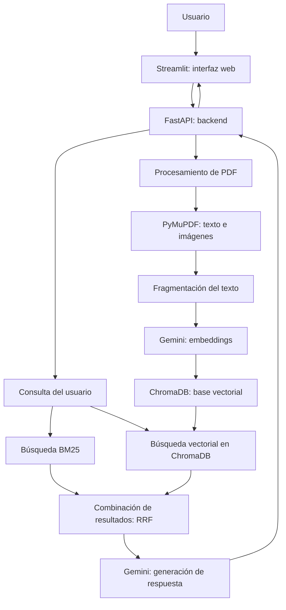

# Sistema RAG Multimodal para consultar documentos PDF

## 1. ¿Por qué se realizó este proyecto?

Este proyecto fue desarrollado como parte de una prueba técnica para el cargo de Ingeniero de Software enfocado en la integración de inteligencia artificial en La Fortuna S.A.

El propósito de la prueba es demostrar cómo se pueden integrar diferentes herramientas de programación e inteligencia artificial para construir una aplicación que permita consultar información de documentos PDF.

En muchas ocasiones, los documentos contienen varias páginas, imágenes y datos técnicos. Encontrar una información específica puede tomar tiempo si debemos revisar todo el archivo manualmente.

Por esta razón, desarrollé un sistema que permite cargar documentos PDF y hacer preguntas sobre su contenido.

El objetivo es facilitar la búsqueda de información y presentar respuestas acompañadas de las fuentes consultadas.

Durante el desarrollo también pude aplicar conocimientos de Python, desarrollo de API, manejo de archivos, bases de datos y pruebas de software, además de aprender a integrar nuevas herramientas de inteligencia artificial.

## 2. ¿De qué trata este proyecto?

Este proyecto consiste en una aplicación web que permite subir documentos PDF y realizar preguntas sobre la información que contienen.

Por ejemplo, si una persona carga un documento de varias páginas, puede preguntar de qué trata, qué información incluye o dónde se menciona un tema específico.

El sistema busca información relacionada dentro del PDF y utiliza Google Gemini para generar una respuesta basada en el contenido recuperado.

Además, la aplicación muestra el nombre del documento y las páginas utilizadas como fuentes.

También permite visualizar imágenes extraídas del archivo PDF.

Para conseguirlo, utilicé una técnica llamada RAG.

## 3. ¿Qué significa RAG?

RAG significa *Retrieval-Augmented Generation*, que en español puede entenderse como generación de respuestas apoyada en la recuperación de información.

La idea es sencilla.

Cuando hacemos una pregunta a una inteligencia artificial, normalmente esta responde utilizando los conocimientos que adquirió durante su entrenamiento.

Con RAG hacemos algo diferente: primero buscamos información en nuestros propios documentos y después se la proporcionamos a la inteligencia artificial para que genere una respuesta.

En este proyecto, el proceso es el siguiente:

1. El usuario carga un documento PDF.
2. El sistema extrae el texto y las imágenes.
3. El texto se divide en fragmentos más pequeños.
4. Se generan representaciones numéricas del texto llamadas embeddings.
5. Los fragmentos se almacenan para facilitar las búsquedas.
6. El usuario realiza una pregunta.
7. El sistema busca los fragmentos más relacionados con la pregunta.
8. Gemini recibe la pregunta y la información encontrada.
9. La aplicación muestra una respuesta, las fuentes y, cuando corresponde, imágenes del documento.

### ¿Por qué utilicé RAG?

Porque quería que las respuestas estuvieran relacionadas con la información de los documentos cargados por el usuario.

Esta técnica ayuda a reducir la dependencia del conocimiento general del modelo de inteligencia artificial.

Sin embargo, no garantiza que todas las respuestas sean correctas. Por eso es importante mostrar las fuentes y permitir que el usuario pueda revisarlas.

## 4. Herramientas utilizadas

### Python

Python es el lenguaje de programación principal de la aplicación.

Lo utilicé para escribir el backend, la interfaz, el procesamiento de documentos y las pruebas.

### FastAPI

FastAPI es una herramienta de Python que permite crear una API.

Una API funciona como un medio de comunicación entre diferentes partes de una aplicación.

En este proyecto, FastAPI recibe los documentos enviados desde la interfaz, coordina su procesamiento y recibe las preguntas de los usuarios.

También permite consultar el estado de cada trabajo y recuperar imágenes extraídas de los PDF.

### Streamlit

Streamlit permite crear interfaces web utilizando Python.

Lo utilicé para desarrollar la parte visual de la aplicación, porque permite construir una interfaz sencilla sin necesitar un frontend desarrollado completamente con HTML, CSS y JavaScript.

Desde Streamlit, el usuario puede:

- Seleccionar y cargar un PDF.
- Iniciar su procesamiento.
- Consultar el estado del documento.
- Escribir preguntas.
- Leer las respuestas.
- Consultar las fuentes.
- Visualizar imágenes extraídas.

### Google Gemini

Gemini es el servicio de inteligencia artificial de Google utilizado en el proyecto.

Cumple dos funciones.

**Generación de embeddings:** permite convertir los textos en representaciones numéricas para buscar información relacionada por su significado.

**Generación de respuestas:** recibe la pregunta junto con los fragmentos recuperados y produce una respuesta en lenguaje natural.

Para utilizar este servicio se necesita una clave de API, que se configura en un archivo privado llamado `.env`.

### ¿Qué son los embeddings?

Los embeddings son listas de números que representan características del significado de un texto.

Por ejemplo, las expresiones "cómo configurar el sistema" y "pasos para instalar la aplicación" pueden estar relacionadas aunque no utilicen exactamente las mismas palabras.

Los embeddings ayudan al sistema a encontrar fragmentos con significados parecidos.

### PyMuPDF

PyMuPDF es una librería que permite trabajar con archivos PDF.

La utilicé para extraer texto e imágenes de los documentos.

También permite obtener información sobre las páginas y las posiciones de algunos elementos, mediante coordenadas llamadas bounding boxes.

### ChromaDB

ChromaDB es una base de datos vectorial.

A diferencia de una base de datos tradicional, permite almacenar representaciones numéricas del texto y buscar información con significado similar.

En este proyecto se utiliza para guardar los embeddings de los fragmentos y recuperarlos durante las consultas.

La información se almacena de forma persistente en una carpeta del proyecto.

### BM25

BM25 es un método de búsqueda por palabras clave.

Permite identificar fragmentos relacionados con los términos utilizados en una pregunta.

Por ejemplo, si el usuario pregunta por "requisitos de instalación", BM25 puede localizar fragmentos que contengan esas palabras.

### Búsqueda híbrida

La búsqueda híbrida combina dos métodos:

- BM25, que busca coincidencias relevantes entre palabras.
- Búsqueda vectorial con ChromaDB, que busca similitud de significado.

Después se combinan los resultados utilizando RRF, un método que considera la posición de los fragmentos en los resultados de ambas búsquedas.

Elegí esta combinación porque los dos métodos pueden complementarse.

### Pytest

Pytest es una herramienta para realizar pruebas automatizadas en Python.

Permite comprobar partes del programa y detectar errores.

En algunas pruebas utilicé simulaciones, conocidas como mocks, para verificar componentes sin depender de llamadas reales a Gemini o a la base vectorial.

### Docker y Docker Compose

Docker permite ejecutar aplicaciones dentro de contenedores.

Un contenedor reúne el programa y las dependencias necesarias para ejecutarlo en un entorno preparado.

Docker Compose permite iniciar varios servicios mediante un mismo archivo de configuración.

En este proyecto se configuraron dos servicios:

- Backend con FastAPI.
- Frontend con Streamlit.

La configuración fue probada en GitHub Codespaces y se verificó el funcionamiento de ambos servicios.

## 5. ¿Cómo funciona la aplicación?

### Primera parte: carga y procesamiento del PDF

El usuario selecciona un PDF desde Streamlit.

La interfaz envía el archivo al backend mediante FastAPI.

El backend crea un identificador único para el trabajo, llamado `job_id`.

Este identificador permite consultar el estado de procesamiento del documento.

Los estados utilizados son:

- `Pending`: el documento está pendiente de procesamiento.
- `Processing`: el documento se está procesando.
- `Completed`: el procesamiento terminó correctamente.
- `Failed`: ocurrió un error.

Para evitar que el usuario tenga que esperar a que termine toda la tarea antes de recibir una respuesta de la API, se utilizan las tareas en segundo plano de FastAPI.

Durante el procesamiento, PyMuPDF extrae el texto y las imágenes.

El texto se divide en fragmentos más pequeños y se generan embeddings para guardarlos en ChromaDB.

### Segunda parte: consultar el documento

Cuando el documento está procesado, el usuario puede escribir una pregunta.

El backend utiliza BM25 y ChromaDB para buscar información relacionada con esa pregunta.

Después se combinan los resultados y se seleccionan los fragmentos más relevantes.

Estos fragmentos se envían a Gemini junto con la pregunta y las instrucciones para responder utilizando solamente el contexto proporcionado.

Finalmente, la aplicación muestra la respuesta y las páginas utilizadas como fuentes.

### Tercera parte: mostrar imágenes

Durante el procesamiento también se extraen imágenes del PDF.

Las imágenes se guardan por separado y se relacionan con las páginas de origen.

Cuando las fuentes recuperadas corresponden a páginas que contienen imágenes, la interfaz puede mostrar esas imágenes junto con la respuesta.

Actualmente, la relación entre imágenes y texto se realiza principalmente mediante la página del documento.

Este funcionamiento todavía puede mejorarse para identificar con mayor precisión qué imagen corresponde a cada fragmento de texto.

## 6. Diagrama de arquitectura

El siguiente diagrama muestra cómo se relacionan las partes principales de la aplicación.



### Explicación del diagrama

El usuario interactúa con la aplicación desde Streamlit.

Streamlit envía las solicitudes a FastAPI, que coordina el funcionamiento del sistema.

Cuando se carga un PDF, se extrae su contenido, se divide el texto en fragmentos y se generan embeddings que se almacenan en ChromaDB.

Cuando se realiza una pregunta, el sistema utiliza BM25 y ChromaDB para buscar información relevante.

Después combina los resultados y envía el contexto seleccionado a Gemini.

Finalmente, la respuesta vuelve al backend y se muestra en Streamlit, acompañada de sus fuentes y de las imágenes relacionadas que estén disponibles.

## 7. Organización del proyecto

La estructura principal es:

```text
Prueba_RAG/
|
|-- backend/
|   |-- app/
|       |-- main.py
|       |-- services/
|
|-- frontend/
|   |-- app.py
|
|-- tests/
|
|-- Dockerfile
|-- docker-compose.yml
|-- requirements.txt
|-- requirements-docker.txt
|-- .env.example
|-- .gitignore
|-- .dockerignore
|-- README.md
```

**backend:** contiene la API y los servicios que procesan los documentos, realizan búsquedas y generan respuestas.

**frontend:** contiene la interfaz visual desarrollada con Streamlit.

**tests:** contiene las pruebas automatizadas.

**Dockerfile:** contiene las instrucciones para construir la imagen de Docker.

**docker-compose.yml:** configura los contenedores del frontend y el backend.

**requirements.txt:** contiene las dependencias del entorno local de desarrollo.

**requirements-docker.txt:** contiene las dependencias principales utilizadas para construir los contenedores.

**.env.example:** muestra cómo configurar la variable de Gemini sin incluir la clave real.

**.gitignore:** evita incluir determinados archivos privados o innecesarios en Git.

**.dockerignore:** evita copiar archivos privados o innecesarios durante la construcción de las imágenes.

**README.md:** contiene la documentación del proyecto.

## 8. Decisiones técnicas

### ¿Por qué utilicé Python?

Porque es un lenguaje con el que puedo trabajar en backend, procesamiento de documentos, inteligencia artificial y pruebas automatizadas.

### ¿Por qué FastAPI?

Porque permite crear una API REST en Python y ofrece funcionalidades para validar solicitudes, recibir archivos y ejecutar tareas en segundo plano.

### ¿Por qué Streamlit?

Porque necesitaba desarrollar una interfaz sencilla para demostrar el funcionamiento del sistema.

Streamlit permite construirla directamente en Python.

### ¿Por qué dividí el texto en fragmentos?

Porque un PDF puede contener muchas páginas y no resulta práctico enviar todo su contenido a Gemini cada vez que un usuario hace una pregunta.

La fragmentación permite buscar primero las partes más relacionadas con la consulta.

En esta implementación se aprovecha información de la distribución del texto en las páginas, como bloques y columnas, en lugar de depender únicamente de cortes por cantidad de caracteres.

### ¿Por qué utilicé ChromaDB?

Porque permite almacenar embeddings y recuperar fragmentos mediante búsqueda vectorial.

Además, cuenta con almacenamiento persistente, lo que resulta útil para conservar los datos procesados.

### ¿Por qué combiné BM25 y búsqueda vectorial?

Porque cada método permite encontrar información de una manera diferente.

BM25 considera las palabras utilizadas en la consulta, mientras que la búsqueda vectorial identifica similitud de significado.

La combinación busca aprovechar ambas ventajas.

### ¿Por qué utilicé tareas en segundo plano?

Porque procesar un PDF y generar embeddings puede tardar.

Con las tareas en segundo plano, la API puede devolver un identificador del trabajo y permitir que el usuario consulte su progreso.

### ¿Por qué utilicé Docker Compose?

Porque permite configurar y ejecutar los dos componentes principales de la aplicación con un solo comando.

Esto facilita preparar un entorno de prueba sin iniciar cada servicio manualmente.

## 9. Configuración del proyecto

Para utilizar la aplicación se necesita una clave de API de Google Gemini.

Se debe crear un archivo `.env` en la carpeta principal.

Su contenido debe ser:

```dotenv
GEMINI_API_KEY=tu_clave_de_gemini
```

El valor de ejemplo se debe reemplazar por una clave válida.

**Importante:** el archivo `.env` no debe publicarse en GitHub ni compartirse con otras personas.

El repositorio incluye `.env.example` como referencia.

## 10. Ejecución local

Para ejecutar el proyecto localmente se necesita Python y una clave válida de Gemini.

### Paso 1. Descargar el proyecto

Descargar el repositorio desde GitHub o clonarlo utilizando Git.

### Paso 2. Crear un entorno virtual

En Windows, dentro de la carpeta del proyecto, ejecutar:

```powershell
python -m venv .venv
```

Activarlo con:

```powershell
.\.venv\Scripts\Activate.ps1
```

### Paso 3. Instalar las dependencias

```powershell
python -m pip install -r requirements.txt
```

### Paso 4. Configurar Gemini

Crear el archivo `.env` con la clave correspondiente.

### Paso 5. Iniciar el backend

En una terminal:

```powershell
python -m uvicorn backend.app.main:aplicacion --reload
```

El backend estará disponible en:

http://localhost:8000

La documentación automática de FastAPI estará disponible en:

http://localhost:8000/docs

### Paso 6. Iniciar el frontend

Abrir una segunda terminal y ejecutar:

```powershell
python -m streamlit run frontend/app.py
```

La interfaz estará disponible en:

http://localhost:8501

Para utilizar el sistema se deben mantener los dos servicios en ejecución.

## 11. Ejecución con Docker Compose

El proyecto incluye un `Dockerfile` y un archivo `docker-compose.yml`.

Estos archivos permiten construir y ejecutar los servicios del backend y frontend utilizando Docker Compose.

Primero se debe crear y configurar el archivo `.env` con una clave válida de Gemini.

Después, desde la carpeta principal, ejecutar:

```bash
docker compose up --build
```

Este comando construye las imágenes y ejecuta ambos servicios.

Las direcciones locales previstas son:

- FastAPI: http://localhost:8000
- Streamlit: http://localhost:8501

Para detener los servicios:

```bash
docker compose down
```

### Verificación realizada

La configuración fue probada en GitHub Codespaces.

Durante la prueba se verificó lo siguiente:

1. Construcción correcta de las imágenes de Docker.
2. Inicio del backend y frontend.
3. Respuesta correcta de FastAPI.
4. Carga de un documento PDF desde Streamlit.
5. Procesamiento e indexación de 29 fragmentos.
6. Consulta en lenguaje natural utilizando Gemini.
7. Presentación de una respuesta con fuentes correspondientes a páginas del documento.
8. Visualización de una imagen extraída del PDF.

Esta prueba permitió comprobar el flujo principal de la aplicación dentro de contenedores.

No significa que la aplicación haya sido probada para todos los escenarios ni que esté lista para uso en producción.

## 12. Pruebas automatizadas

Se desarrollaron tres pruebas utilizando Pytest.

Estas pruebas verifican:

1. El funcionamiento básico del gestor de trabajos.
2. La lógica del servicio Gemini utilizando una respuesta simulada.
3. La búsqueda híbrida utilizando componentes simulados.

Para ejecutar las pruebas:

```powershell
python -m pytest tests -v
```

Durante el desarrollo local, las tres pruebas terminaron correctamente.

Además, se realizaron pruebas manuales de procesamiento documental, búsquedas, consulta de fuentes y visualización de imágenes.

Es importante aclarar que las pruebas automatizadas cubren algunas partes del sistema, pero todavía no todos los casos posibles.

## 13. Manejo de errores

Durante el desarrollo se presentaron algunas dificultades relacionadas con la disponibilidad del servicio Gemini.

En ciertas solicitudes se recibieron errores temporales del proveedor externo.

Por eso se incorporó un mecanismo de reintentos para determinadas situaciones, como errores temporales del servicio o límites de solicitudes.

También se añadieron mensajes para distinguir algunos errores de conexión y tiempos de espera en la interfaz.

El backend registra determinadas operaciones y errores para facilitar su revisión.

Estas medidas ayudan a identificar y manejar algunos fallos, aunque todavía pueden mejorarse.

## 14. Dificultades encontradas

### Integración con Gemini

Durante algunas consultas, Gemini presentó errores temporales de disponibilidad.

Esto permitió identificar la necesidad de controlar fallos de servicios externos y evitar depender de una sola respuesta.

### Organización de documentos

También fue necesario identificar los fragmentos de cada documento para relacionar correctamente las búsquedas con el archivo seleccionado.

### Ejecución de Docker

El computador utilizado para el desarrollo tenía recursos limitados para ejecutar Docker Desktop.

Por esta razón, utilicé GitHub Codespaces como entorno Linux para realizar las pruebas de los contenedores.

Durante la primera ejecución se identificó que el backend intentaba abrir automáticamente un archivo de prueba que no existía dentro del contenedor.

Se corrigió el inicio del backend para que no dependiera de ese archivo.

Después de la corrección se comprobó el funcionamiento del sistema con un PDF real de prueba.

## 15. Limitaciones conocidas

Este proyecto es un prototipo funcional desarrollado para una evaluación técnica.

Actualmente presenta algunas limitaciones:

- La generación de embeddings y respuestas depende de la disponibilidad del servicio Gemini.
- La extracción de tablas como estructuras independientes no está implementada completamente.
- La relación entre imágenes y fragmentos de texto se realiza principalmente mediante las páginas del documento.
- No se interpreta completamente el contenido visual de diagramas e imágenes.
- El procesamiento utiliza tareas en segundo plano de FastAPI, no una cola de procesamiento distribuida.
- No se implementaron interfaces formales para sustituir fácilmente todos los proveedores externos.
- Las pruebas automatizadas todavía no cubren toda la aplicación.
- La ejecución principal fue verificada en Docker Compose, pero no se realizaron pruebas de carga ni de escalabilidad para producción.

## 16. Posibles mejoras

En una versión futura se podría:

- Mejorar la extracción estructurada de tablas.
- Asociar con mayor precisión imágenes y fragmentos mediante sus coordenadas.
- Implementar una arquitectura más desacoplada mediante interfaces.
- Utilizar una cola de trabajos para procesar grandes cantidades de documentos.
- Ampliar las pruebas automatizadas.
- Añadir validaciones y límites de seguridad adicionales para los PDF.
- Mejorar el registro y seguimiento de errores.
- Realizar pruebas de rendimiento con varios documentos.

## 17. Conclusión

Este proyecto permitió desarrollar una aplicación que combina el procesamiento de documentos PDF con búsquedas y generación de respuestas mediante inteligencia artificial.

Uno de los aprendizajes principales fue comprender que un sistema RAG no consiste solamente en enviar preguntas a Gemini.

También requiere preparar los documentos, extraer información, dividir el contenido, generar embeddings, almacenar datos y recuperar los fragmentos adecuados antes de producir una respuesta.

Durante el desarrollo pude practicar la integración de API, bases de datos vectoriales, procesamiento de PDF, pruebas automatizadas y ejecución de aplicaciones mediante Docker.

El resultado es un prototipo funcional que permite consultar documentos PDF y mostrar respuestas con sus fuentes e imágenes relacionadas.
